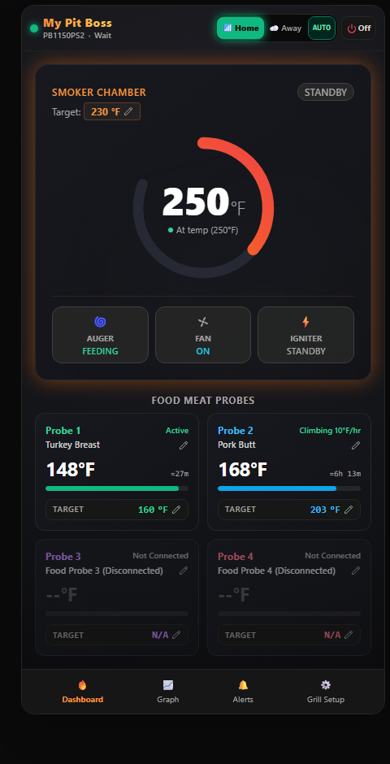
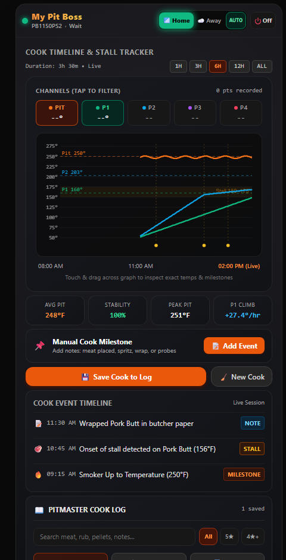

# SmokeMaster for Pit Boss (Android)

**SmokeMaster** is a free, ad-free, standalone Android app for Wi-Fi-enabled Pit Boss pellet grills (`PBL-...` controllers). It connects directly to your smoker over your home Wi-Fi, automatically switches to Pit Boss Cloud Relay when you leave home, runs its own background monitor for lock-screen alerts, and archives full cook temperature curves and tasting notes.

> **Independent Community App:** SmokeMaster is **not** an official Google Play Store app and is **not** affiliated with Pit Boss or Dansons.

---

## Downloads ([Latest Release: v1.1](https://github.com/davis1862-star/smokemaster-pitboss/releases/tag/v1.1))
* **`SmokeMaster-v1.1.apk`** — Android installer (Android 5.1+, recommended Android 8.0–15+)
* **`SmokeMaster-User-Guide.pdf`** — Complete setup, controls, graphing, and Cook Log walkthrough
* **`SmokeMaster-Compatibility-Guide.pdf`** — Supported Pit Boss models, Android versions, and network requirements

---

## Screenshots
| Live Dashboard | Cook Timeline & Stall Tracker |
| :---: | :---: |
|  |  |
## Key Features
* **Zero Hardcoded Grill Setup & Auto-Find:** Tap **Auto-Find My Pit Boss** on home Wi-Fi to automatically detect your grill's local IP and `PBL-...` Cloud Device ID in ~3 seconds — no Wi-Fi passwords stored in the app.
* **Home Wi-Fi + Auto Away Mode:** Polls locally over home Wi-Fi, automatically switches to Cloud Relay over cellular when you leave home, and switches back when you return.
* **On-Phone Background Cook Monitor:** Native Android Foreground Service keeps temperature graphing and lock-screen alarms running while your phone is in your pocket (no PC server or separate alert app needed).
* **Smart Probe "Time Left" Estimates:** 15m + 35m least-squares trend regression with Newton's Law of Heating curve adjustment and automatic gap breaking.
* **Cook Timeline & Pitmaster Cook Log:** Touch-to-scrub temperature graph (10s resolution for 2h, 1-min averages up to 4,000 points), stall detection (`150–175°F`), manual milestones, post-cook rating & tasting note edits, CSV export, and 1-tap Google Drive / local file backup.

---

## Installing the APK on Android
1. Download `SmokeMaster-v1.1.apk` on your Android phone and tap it to install.
2. Allow **"Install unknown apps"** for your browser/file manager if prompted.
3. **Google Play Protect:** Because SmokeMaster is an independent APK (not from the Google Play Store), Play Protect may display *"Unrecognized app"*. Tap **More details → Install anyway** (or allow the scan) to continue.
4. Allow **Notifications** and tap **Allow Unrestricted Battery** inside **Grill Setup → Background Cook Monitor** so Android does not pause alerts when the screen is off.

---

## Compatibility Summary
* **Android:** Android 8.0–15+ recommended (minimum Android 5.1 / API 22). No iOS/iPhone version.
* **Grills:** Tested on **Pit Boss Pro Series PB1150PS2**. Expected to work on other Wi-Fi Pit Boss models using the `PBL-` Mongoose/Dansons controller over 2.4 GHz Wi-Fi. Bluetooth-only Pit Boss models and other grill brands are not supported.

---

## Feedback & Test Release Disclaimer
Provided as-is for community testing; no technical support can be provided.  
Bug reports, grill model compatibility notes, and suggestions are welcome via **[GitHub Issues](../../issues)** or email at **`smokemaster.feedback@gmail.com`**.

